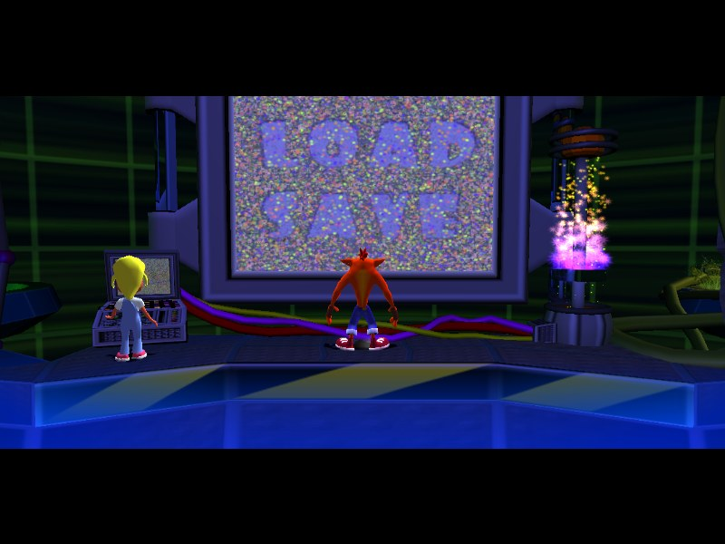
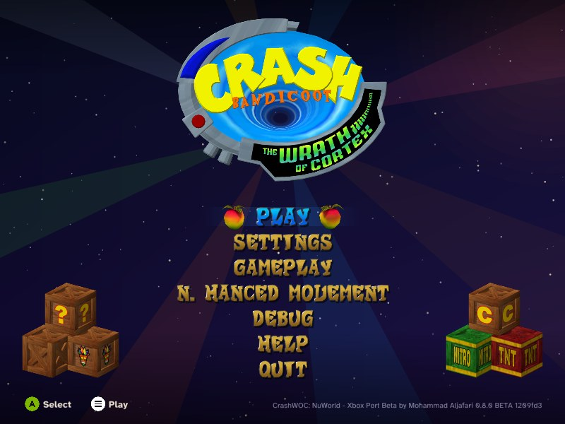
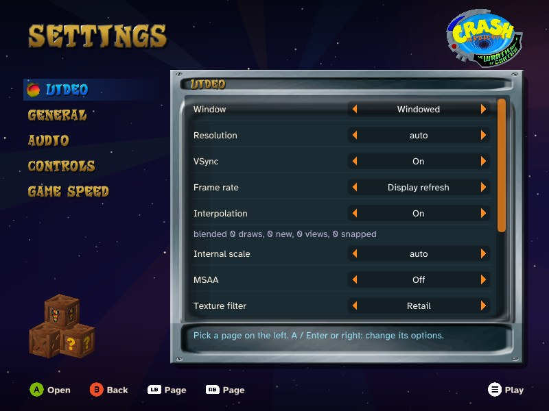
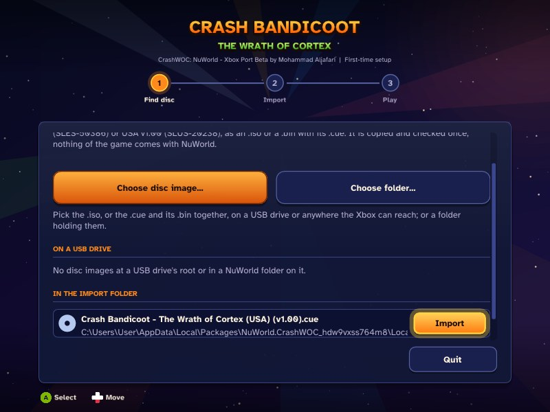
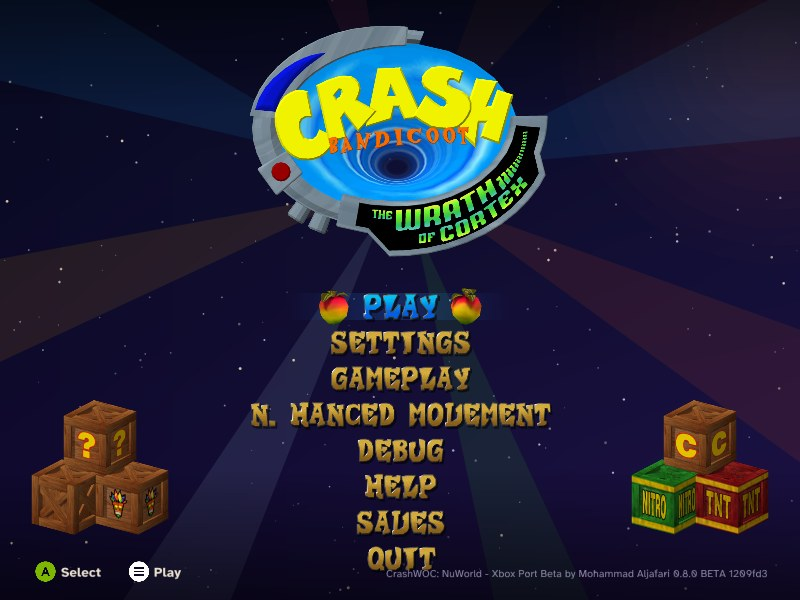

# CrashWOC: NuWorld — Xbox Port Beta

Crash Bandicoot: The Wrath of Cortex running natively on Xbox One / Xbox Series X|S (Developer Mode).

## Pictures

| | |
|---|---|
|  |  |
|  |  |
|  |  |

## How to install

You need an Xbox in **Developer Mode**, a PC on the same network, and your own copy of the game: PAL v1.03
(SLES-50386) or USA v1.00 (SLUS-20238), as `.iso` or `.bin` + `.cue`.

1. Download from [Releases](../../releases/latest): `NuWorld_<version>_x64.msix` and
   `Microsoft.VCLibs.x64.14.00.appx`.
2. On the Xbox, open **Dev Home**, turn on **Remote Access** and note the Device Portal address
   (`https://<xbox-ip>:11443`).
3. On the PC, open that address in a browser and sign in.
4. **Add** → choose the `.msix` → **Next** → add `Microsoft.VCLibs.x64.14.00.appx` → **Start**.
5. In Dev Home, highlight **CrashWOC: NuWorld (Xbox Port Beta)** → **View details** → **App type: Game**.
6. Start the app, press **Choose disc image…** and pick your `.iso` (or the `.cue` and `.bin` together).
   It imports once, then press **Menu** to play.

## Credits

**Xbox port:** Mohammad Aljafari ([@dgamermohammad09](https://github.com/dgamermohammad09))

**Original project:** [NuWorld](https://github.com/denzi-gh/crashwoc-nuworld) and the
[decompilation](https://github.com/denzi-gh/crashwoc-decomp-ps2) by [denzi-gh](https://github.com/denzi-gh)
