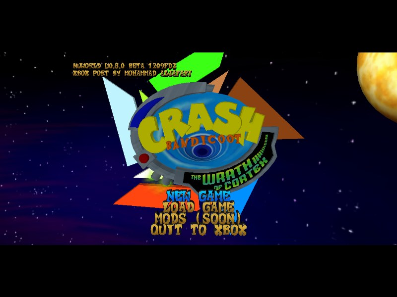

# CrashWOC: NuWorld — Xbox Port Beta

**Crash Bandicoot: The Wrath of Cortex running natively on Xbox One / Xbox Series X|S (Developer Mode).**
Xbox port by **Mohammad Aljafari**, based on [NuWorld](https://github.com/denzi-gh/crashwoc-nuworld) by denzi-gh.

This is **not an emulator**. NuWorld runs the game's own code, rebuilt from the
[decompilation](https://github.com/denzi-gh/crashwoc-decomp-ps2), and this port compiles that code as a native x64
UWP app for the Xbox. It contains **no game data**: you need your own copy of the game, PAL v1.03 (SLES-50386) or
USA v1.00 (SLUS-20238), as `.iso` or `.bin` + `.cue`.

> **Beta.** Built and tested in the Xbox app sandbox on PC. Please report what works and what doesn't on your
> console (see [Reporting a problem](#reporting-a-problem)).

| | |
|---|---|
|  |  |
| The game's title screen | In the game |
|  |  |
| The launcher: every setting before the game starts | Settings pages (video, sound, controls, gameplay, N. Hanced Movement, debug) |
|  |  |
| First start: choose your disc image | View + Menu in the game: the settings again |

## Features

- Native Xbox app: the game's code compiled for the console, no emulation.
- Four renderers: **Direct3D 11** (default), Direct3D 12, OpenGL (Mesa on D3D12) and Vulkan (Mesa Dozen,
  experimental). Choose in the launcher's Video page.
- A launcher in the game's own style (its logo, font, crates, Wumpa fruit and menu sounds, read from your disc) with
  every setting and debug option, before the game starts.
- Full controller support, rumble, Xbox button prompts.
- Autosave plus 100 manual save slots, 50/60 Hz, any aspect ratio, frame interpolation, draw distance, MSAA,
  N. Hanced Movement for Crash, Coco and every vehicle (or the original movement), and the other NuWorld features.

## Install on your Xbox

You need an Xbox in **Developer Mode** (the Dev Mode Activation app from the Microsoft Store and a developer account),
and a PC on the same network.

1. **Download** the latest release from the [Releases](../../releases/latest) page:
   - `NuWorld_<version>_x64.msix`
   - `Microsoft.VCLibs.x64.14.00.appx` (dependency)
2. On the Xbox, start **Dev Home**, turn on **Remote Access** and note the Device Portal address
   (`https://<xbox-ip>:11443`).
3. On the PC, open that address in a browser (accept the certificate warning) and sign in.
4. **Home → Add**. Choose the `.msix`, press **Next**, add `Microsoft.VCLibs.x64.14.00.appx` as a dependency, then
   **Start**. Wait for "Package successfully registered".
5. In Dev Home, highlight **CrashWOC: NuWorld (Xbox Port Beta)**, press **View** (the two squares) → **View details**
   → **App type: Game**. (Games get more memory and the full GPU.)
6. Start the app.

## First start: add your disc

The app starts on a setup page that asks for your disc image (`.iso`, or `.bin` + `.cue`). Use any of these:

- **Choose disc image…** opens the Xbox file picker. Pick the `.iso`, or the `.cue` **and** its `.bin` together.
- **Choose folder…** picks a folder that holds the image.
- **USB drive**: put the image at the root of a USB drive or in a `NuWorld` folder on it; it shows up in the list
  under *On a USB drive*. NTFS drives must allow apps to read them once, from a PC:
  `icacls X:\ /grant "*S-1-15-2-1:(OI)(CI)RX"` (X = the drive letter).
- **Device Portal**: File explorer → LocalAppData → NuWorld.CrashWOC_… → LocalState → crashwoc-nuworld → import,
  upload the image, then press **Import** in the list.

The image is copied, checked and imported once (about 500 MB, a minute or two). Then the launcher opens; press
**Menu** to play.

## Controls

| Button | Launcher / setup | In the game |
|---|---|---|
| D-pad / left stick | Move between options | Move |
| D-pad left / right | Change a value | |
| A | Choose | Jump (PS2 ✕) |
| B | Back | Crouch / slide (PS2 ○) |
| X | | Spin (PS2 □) |
| LB / RB | Previous / next page | |
| Menu | Start the game | Pause |
| View + Menu together | | The launcher's settings over the game |

Game buttons can be remapped in Settings → Controls.

## Reporting a problem

Open an [issue](../../issues) with what you did and what happened, and attach the two log files from the app's data
folder (Device Portal → File explorer → LocalAppData → NuWorld.CrashWOC_… → LocalState → crashwoc-nuworld):
`nuworld.log` and `stdout.txt`.

## Building from source

The Xbox build: see [xbox/README.md](xbox/README.md) (toolchain, SDL3-uwp + our patch in
[xbox/patches](xbox/patches), packaging, renderers). Renderer design and verification:
[xbox/RENDERERS.md](xbox/RENDERERS.md). The PC build is unchanged from NuWorld: see
[docs/NUWORLD_README.md](docs/NUWORLD_README.md).

```
git clone --recursive https://github.com/dgamermohammad09/CrashWOC-Xbox-Port.git
```

## Credits

- **Xbox port:** Mohammad Aljafari ([@dgamermohammad09](https://github.com/dgamermohammad09))
- **NuWorld** (the native PC port this is built on) and the **decompilation**: [denzi-gh](https://github.com/denzi-gh)
  and contributors — [crashwoc-nuworld](https://github.com/denzi-gh/crashwoc-nuworld),
  [crashwoc-decomp-ps2](https://github.com/denzi-gh/crashwoc-decomp-ps2)
- [SDL3-uwp](https://github.com/XboxEmulationHub/SDL3-uwp) and [mesa-uwp](https://github.com/XboxEmulationHub/mesa-uwp)
  (XboxEmulationHub), [SDL3](https://libsdl.org), [Mesa](https://mesa3d.org), [Dear ImGui](https://github.com/ocornut/imgui)
- [Kenney](https://kenney.nl) Input Prompts (CC0), Atkinson Hyperlegible (SIL OFL), SPU2 interpolation table and
  reverb filter from [PCSX2](https://pcsx2.net)

Crash Bandicoot is a trademark of Activision. This project is not affiliated with or endorsed by Activision or
Microsoft, and ships no game data.

## License

GPL-3.0, see [LICENSE](LICENSE).
